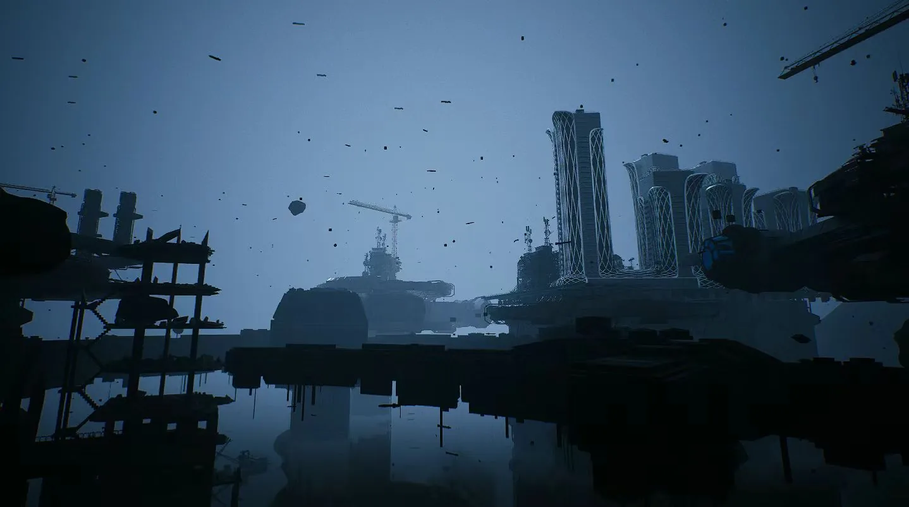
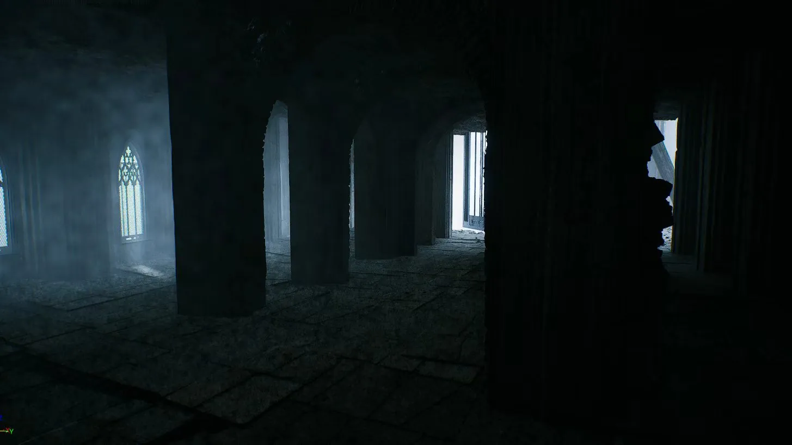
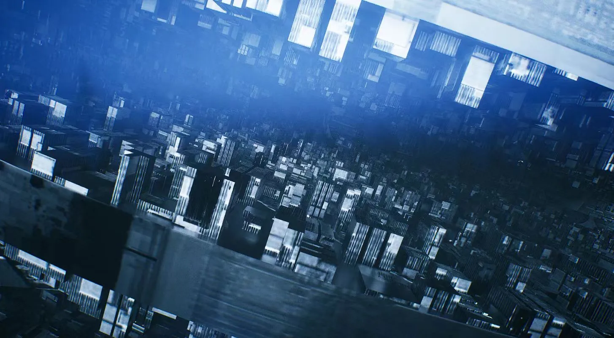

# 失序 / SHIXU

**An Unreal Engine environment-art and technical-art research project.**  
*原《骸械纪》课程合作项目的持续返修与研究。*

> **Archive / 历史资料** — 本页的旧版局内截图来自原《骸械纪》课程项目阶段，**不是当前恢复后新版本的实时运行结果**。当前已完成归档CRC、匹配引擎安装与隔离文件恢复；运行诊断已开始，地图测试和艺术返修仍以实际证据为准。负责人已确认13张历史截图展示权限；旧作六人合作、具体贡献待核实。第三方源资产未公开。

---

## The World / 原作世界

庞大的工业构筑物悬于失重空间，桥梁连向未知的塔架；石质遗迹以重复的柱列、暗部和出口亮光引导观看。项目以这些空间为已有美术基础，继续探索**异常尺度、空间叙事和第一人称可探索性**。

[在线展示](https://lilith-techart.github.io/SHIXU/) · [展示站源码](site/index.html) · [恢复状态](docs/RECOVERY_STATUS.md) · [贡献与许可](docs/CONTRIBUTORS.md)

### 东亚重工 / Suspended Industry

<small>LEGACY SCREENSHOT · 原课程阶段历史画面</small>

**研究重点：** 巨构比例、冷雾纵深、桥梁路径、漂浮岩块与巨大球体的视觉主次。

### 安定区 / Stone Corridor

<small>LEGACY SCREENSHOT · 原课程阶段历史画面</small>

**研究重点：** 暗部结构、明亮出口、建筑节奏、尺度参照及第一人称视线引导。

### 端口区 / Mechanical Depths

<small>LEGACY SCREENSHOT · 原课程阶段历史画面</small>

**研究重点：** 垂直空间、结构复杂度、材质辨识度与真实路径可读性。

---

## Current Status / 当前状态

| 阶段 | 当前核实状态 | 后续证据 |
|---|---|---|
| 归档定位 | P0 静态审计完成 | P0 审计与哈希记录（内部） |
| 压缩包 CRC | PASS，退出码0；SHA256与P0一致 | 完整回执已记录 |
| UE 版本 | 已安装匹配5.5.4 / CL40574608 | 实际Build.version与完成的Epic清单已核验 |
| 文件隔离恢复 | Original58.58GB / Working37.96GB；Content保留 | 23,036归档文件与关键hash已核验 |
| `/Game/Main` 编辑器加载 | 已实证打开；运行健康仍 PARTIAL | 7,436 个已加载 Actor；504 个 MapCheck 错误，尚未验证可玩路线 |
| 第一人称路线 | 未完成新的全图验证 | 连续录屏/路线测试 |
| 灯光与雾视觉修复 | 尚未形成新版本对照 | 同机位 Before/After 与参数 diff |
| 论文实验 | 方案与研究问题已形成 | 新 UE 实测与独立结果 |

上述状态依据真实恢复回执更新；未完成步骤不提前宣称 PASS。

---

## Research / 研究方向

### 01 · Spatial Storytelling — 《Control》研究

研究主题：**《实时渲染技术如何参与空间叙事——以〈Control〉及〈失序〉场景实践为例》**。

主要关注建筑尺度与负空间、光照和曝光、体积雾、材质响应及交互反馈如何成为空间信息。分析借鉴作品的方法，不直接复制其受保护场景或游戏素材。

### 02 · Camera & Perception — 《Bodycam》研究协作

规划在同一固定空间、路线和分辨率下，以 A 原生、B 轻度、C 强化成像方式对比视点、曝光、颗粒、运动模糊与空间可读性。研究实际负责人和成果按后续贡献记录区分；没完成的实验只列为计划。

### 03 · Technical Art Practice — UE5

拟通过可复现实景测试记录实时曝光、Lumen、体积介质、反射、Shader/材质、World Partition、地图加载及第一人称运行问题，比较视觉目标、阅读路线和真实渲染成本。每个结果均附环境版本、参数、数据来源及限制。

---

## Reconstruction Roadmap / 返修路线

1. **恢复**：RAR 完整校验 → 匹配 UE5.5.4 → 原样冷基线 → Working 工作副本。
2. **可靠运行**：加载 `/Game/Main`、定位历史区域、修复依赖/流送/材质/蓝图异常。
3. **第一人称**：确认三地区拓扑、路径和碰撞，建立完整地图可游玩体验。
4. **场景艺术**：先石质走廊，再悬浮工业区，最后端口区；逐步接近最初目标视觉。
5. **可复现实验**：同机位、同路径、单变量、真实性能指标与图证据。
6. **公开作品集**：只发布经过许可审查的成品图、录屏、拆解和技术日志。

---

## Credits & Licenses / 贡献与许可

- **Original coursework / 原作阶段：** 课程合作工程。原有团队成员及分工正在逐一核对，不能将全部旧作模型、场景和素材宣称为个人独立制作。
- **Ongoing technical-art redevelopment / 当前研发：** 由项目负责人组织，具体贡献以实际 Git 提交、工作日志、截图/场景文件、研究文本和成员确认记录为准。
- **Related camera study / 相关相机研究：** 《Bodycam》方向与何家睿研究的合作边界将独立记录，未产生的成果不提前署为已完成。
- **Third-party assets / 第三方资产：** Unreal Engine/Fab/Quixel 及任何其他素材必须按实际许可证审查；工程内资产存在不等于具有公开源文件的再分发权。

本仓库展示原作档案与经授权的研发证据；不自动公开完整原始工程、第三方源模型、课程成员个人数据或未审查参考包。

---

<small>Project archive founded on UE5 historical records. Published material is labeled by source and production stage. The current rebuild status is verified only by independently recorded evidence.</small>

Source/project distribution is not currently provided. 本次未选择开源许可证；截图展示授权不等于第三方源资产再分发授权。
